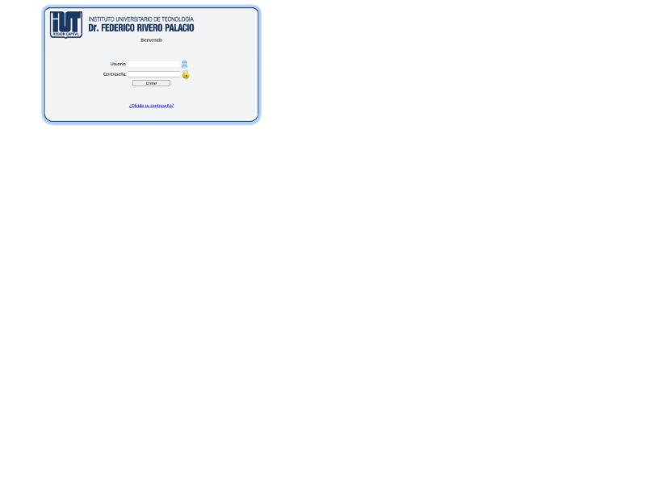
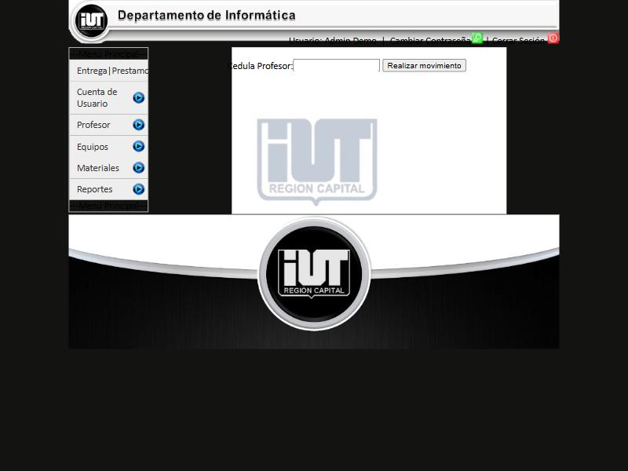
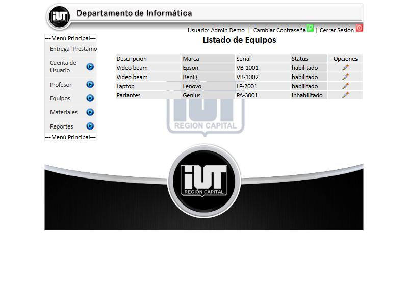
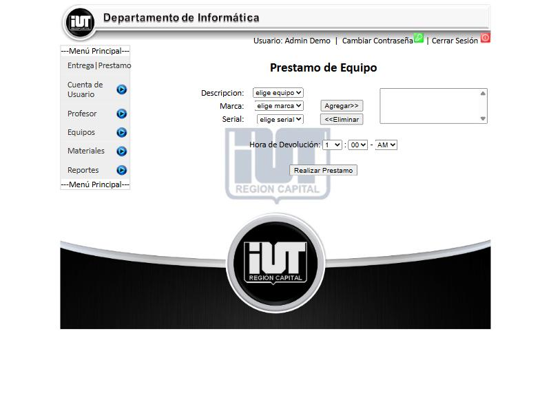
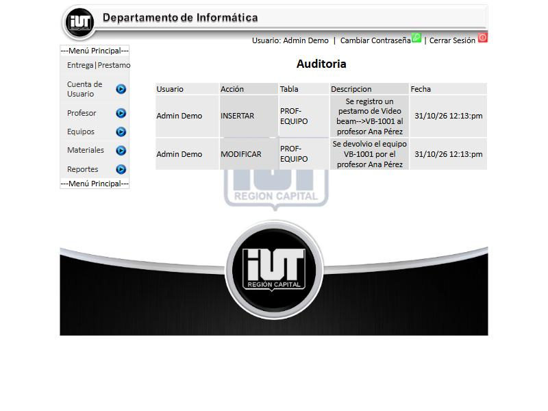

# Proyecto universitario (2011)

Sistema web de control de equipos y materiales de un departamento de informática: préstamos y devoluciones de equipos, entrega de materiales, profesores, usuarios con niveles de acceso, reportes y auditoría. Hecho en PHP y MySQL como proyecto académico en 2011.

> **Nota:** es código antiguo conservado como archivo histórico. No refleja mi nivel ni mis prácticas actuales. La configuración (`config.php`) usa valores locales de desarrollo, sin credenciales reales.

## Capturas

Tomadas de una copia local funcionando, con una base de datos reconstruida y datos ficticios.

| | |
|---|---|
| **Inicio de sesión** |  |
| **Menú principal** |  |
| **Listado de equipos** |  |
| **Préstamo de equipo** |  |
| **Auditoría de acciones** |  |

## Qué incluye

- Usuarios con dos niveles (administrador y operador) y recuperación de clave con pregunta secreta.
- Registro de profesores, equipos y materiales.
- Préstamo y devolución de equipos con hora de devolución, y entrega de materiales con control de existencias.
- Reportes por profesor y por rango de fechas.
- Auditoría de las acciones realizadas.
- Capa de datos separada en clases (`clases/class_DAO_*.php`).

## Cómo ejecutarlo

Necesita PHP y MySQL/MariaDB. El código usa las funciones `mysql_*`, que desaparecieron en PHP 7, así que requiere PHP 5.x o una capa de compatibilidad con `mysqli`. **La base de datos no está incluida en este repositorio** (no conservo el respaldo original); las tablas se pueden deducir de las consultas de `clases/class_DAO_*.php`.

## Limitaciones conocidas

Es un proyecto de 2011 y tiene problemas que hoy corregiría:

- Las consultas SQL se arman concatenando texto, lo que permite inyección SQL (hoy usaría consultas preparadas).
- Las contraseñas se guardan con MD5, que ya no es seguro (hoy usaría `password_hash`).
- Usa funciones de PHP eliminadas y maquetación con tablas HTML.
